# Deep Model & Effort Cost-Optimization Analysis

> [!IMPORTANT]
> **Core Cost-Engineering Principle — The Inverted Cost Pyramid:**
> Do **not** use flagship models or `high`/`max` reasoning effort for routine extraction, boilerplate, or template-driven work.
> Instead, assign **~68% of all work** to the most economical model family (**`GPT-6.1-Sol`**), **~24%** to the balanced component-engineering family (**`GPT-6.1-Terra`**), and reserve **only ~8%** for the deep architectural/physics family (**`GPT-6-Luna`**), with **`GPT-6-Luna (max)` restricted to just 2 apex tasks** across the entire project.

---

## 1. Available Model Families & Effort Spectrum

All tasks and subagents in this `/goal` are restricted strictly to these three model families and their effort tiers:

| Model Family | Allowed Effort Tiers | Relative Cost / Token Multiplier (Est.) | Primary Role in the Pyramid |Share of Total Work |
| :--- | :--- | :---: | :--- | :---: |
| **`GPT-6.1-Sol`** | `low`, `medium`, `high` | **1.0× – 2.2×** *(Lowest Cost)* | High-speed verbatim extraction, asset migration, standard `.story.tsx` files, barrel exports, CLI checks, and bulk `.mdx` documentation authoring | **~68%** |
| **`GPT-6.1-Terra`** | `low`, `medium`, `high` | **3.0× – 6.5×** *(Moderate Cost)* | Surgical React refactoring, decoupling `next/*` / `trpc` / `authClient` into props-driven `<*View>` components, stateful widget composition, and `registry.json` engineering | **~24%** |
| **`GPT-6-Luna`** | `low`, `medium`, `high`, `max` | **8.0× – 25.0×** *(Premium Cost)* | Complex 3D CSS `transform-3d` choreography, WAAPI `offsetPath` comets, 2-pass `elkjs` layout math, Shadow DOM 240Hz spring physics, CSS token isolation, and final pixel-parity QA | **~8%** *(only ~2% at `max`)* |

```mermaid
flowchart BT
    subgraph Tier1["Tier 1: Bulk & Structured Execution (~68% of Tasks) — LOWEST COST"]
        SolLow["GPT-6.1-Sol (low) — ~28% of work\nVerbatim copies (45+ decoupled primitives, BrandLogos, fonts, mock-data),\nbarrel index.ts files, meta.json trees, tsc/vitest/build CLI runs"]
        SolMed["GPT-6.1-Sol (medium) — ~22% of work\nPure TS utilities (format, range, payload-messages, hooks),\nsimple leaf widgets, 56 UI primitive .story.tsx files, registry JSON items"]
        SolHigh["GPT-6.1-Sol (high) — ~18% of work\n110+ Fumadocs .mdx pages (Primitives, Widgets, Charts, Figures, Blocks),\nstandard widget/figure .story.tsx files, attribution banners"]
    end

    subgraph Tier2["Tier 2: Surgical Component Engineering & Decoupling (~24% of Tasks) — MODERATE COST"]
        TerraLow["GPT-6.1-Terra (low) — ~7% of work\nPrimitives with custom logic (Button, Badge, Select auto-label, Sheet floating, Table),\nLinkProvider wrapper, unit test suite adaptation"]
        TerraMed["GPT-6.1-Terra (medium) — ~10% of work\nDecoupling moderate widgets (PageHeader, RangePicker, CodeBlock, Markdown,\nContextChip, EvilCharts 11 files, 22 Landing Figures, DriftingFogCTA, CuttingMat)"]
        TerraHigh["GPT-6.1-Terra (high) — ~7% of work\nComplex stateful composites (Toolbar portal-lifting, FilterSelect, PayloadView,\nRunExchange drawer, PromptProse/Versions, AppShellBlock, 7 Dashboard Page Blocks,\nObservabilityGuide scrollytelling, SetupBoard patch editor, FoglampStoryPanel)"]
    end

    subgraph Tier3["Tier 3: Deep Physics, Algorithms & Apex QA (~8% of Tasks) — HIGH PRECISION"]
        LunaLow["GPT-6-Luna (low) — ~2% of work\nCross-wave export/import contract gatekeeper & zero-Next/tRPC leak verification"]
        LunaMed["GPT-6-Luna (medium) — ~2% of work\nMonorepo + TanStack Start + @fumadocs/base-ui + Tailwind v4 CSS token harmony,\n@foglamp/prompts LCS diff/slot inference & 2-pass elkjs orthogonal layout math"]
        LunaHigh["GPT-6-Luna (high) — ~2.5% of work\nTraceTimeline multi-phase waterfall, FlowMap WAAPI BeamPulse + crisp zoom,\nFoggyLauncher SVG corner notch + rubber-band resize, FoglampHUD Shadow DOM 240Hz spring"]
        LunaMax["GPT-6-Luna (max) — ~1.5% of work (ONLY 2 TASKS)\n1. Hero3DDemoBlock (3-Beat transform-3d + Beat 0 dark anti-flicker + 7-tab Demo)\n2. Final Whole-Portal Light/Dark Pixel-Parity & Hydration Audit"]
    end

    SolLow --> SolMed --> SolHigh --> TerraLow --> TerraMed --> TerraHigh --> LunaLow --> LunaMed --> LunaHigh --> LunaMax
```

---

## 2. Granular Analysis of Every Model + Effort Combination

### 2.1 `GPT-6.1-Sol` (`low` → `medium` → `high`) — The Cost-Saving Foundation

Why `GPT-6.1-Sol` handles ~68% of the project:
In `foglamp-labs/foglamp`, **50 of the 56 primitives in `packages/ui/src/components/` already have zero `next/*` or `trpc` imports**, and **`evilcharts/*`, `brand-logos.tsx`, `model-logo.tsx`, `format.ts`, `range.ts`, and `mock-data.ts` (2,094 lines) are already 100% pure React/TypeScript**. Using an expensive reasoning model to copy or lightly re-path these files wastes 5×–20× more compute with zero benefit.

| Model + Effort | Cognitive & Cost Sweet Spot | Specific Tasks Assigned | Why Higher Models Are Unnecessary Here |
| :--- | :--- | :--- | :--- |
| **`GPT-6.1-Sol (low)`** | Zero-branching mechanical transformations, file migrations, directory scaffolding, and running CLI verification commands | • Copying the 48 zero-logic Base UI primitives from `packages/ui/src/components/` (rewriting only `@foglamp/ui/*` internal import aliases if needed). • Copying static assets (`InterVariable.woff2`, `InterVariable-Italic.woff2`, `ai-workshop.webp`), `brand-logos.tsx` (25 SVGs), `demo/mock-data.ts` (2,094 lines). • Generating `index.ts` barrel exports and Fumadocs `meta.json` sidebar files. • Running `tsc --noEmit`, `vitest run`, `shadcn build`, and `bun run build`. | Source files require 0 architectural decisions; `low` effort executes with minimal thinking tokens and maximum throughput. |
| **`GPT-6.1-Sol (medium)`** | Single-file adaptations, pure TS utilities, leaf UI widgets, and pattern-driven `.story.tsx` generation | • Extracting `lib/utils.ts`, `lib/format.ts`, `lib/range.ts`, `lib/trace-timeline.ts`, `lib/payload-messages.ts`, `hooks/use-mobile.ts`, `hooks/use-copied.ts`, `hooks/use-app-hooks.ts`. • Extracting leaf widgets: `model-logo.tsx`, `brand-mark.tsx`, `logo.tsx`, `agent-icon.tsx`, `customer-avatar.tsx`, `tool-icon.tsx`, `span-type.tsx`, `project-icon.tsx` (`<Image>` → ``), `copy-icon.tsx`, `copy-button.tsx`, `stat.tsx`, `relative-time.tsx`, `sunset-card.tsx`, `preset-meta.ts`. • Generating all 56 `.story.tsx` files for UI Primitives from a shared `defineStory` template. • Generating `registry.json` entries for primitives and utilities. | Each file is self-contained (<150 lines) with clear inputs and outputs. `medium` effort provides enough reasoning to map prop types into `defineStory` args accurately. |
| **`GPT-6.1-Sol (high)`** | High-volume technical documentation and multi-variant story synthesis | • Writing **110+ `.mdx` documentation pages** across `foundations/`, `primitives/` (56), `widgets/` (35+), `charts/` (12), `figures/` (22), `blocks/` (18), and `credits.mdx` (prominent shoutout to **Gustavo Fior** `@gustavo-fior` & **Foglamp Labs**). • Authoring `.story.tsx` files for standard widgets, EvilCharts, and the 22 visual figures. | MDX authoring is high-output token generation. `GPT-6.1-Sol (high)` reads component prop interfaces carefully and produces rich, accurate docs at ~1/4 the cost of `Terra` or `Luna`. |

---

### 2.2 `GPT-6.1-Terra` (`low` → `medium` → `high`) — The Component Engineering Workhorse

Why `GPT-6.1-Terra` handles ~24% of the project:
When a component mixes UI rendering with `next/link`, `next/navigation`, `trpc.*.useQuery`, or `authClient`, or coordinates multiple sub-components via React context and `ResizeObserver`, `GPT-6.1-Terra` has the exact code-refactoring precision needed to split data fetching from presentation (`<*View>` pattern) while preserving 100% of DOM structure and Tailwind classes.

| Model + Effort | Cognitive & Cost Sweet Spot | Specific Tasks Assigned | Why This Exact Effort Tier Is Optimal |
| :--- | :--- | :--- | :--- |
| **`GPT-6.1-Terra (low)`** | Custom-logic UI primitives, framework adapter wrappers, and unit test suites | • Auditing & adapting the 8 customized primitives in `packages/ui`: `button.tsx` (`` wrapping + `nativeButton`), `badge.tsx` (14 variants + `` wrapping), `button-styles.ts` (`DRAWER_BUTTON_CLASS`), `select.tsx` (recursive `collectSelectItemLabels`), `sheet.tsx` (`variant="floating"`), `table.tsx` (`ResizeObserver` overflow + `interactive` row hover border suppression), `tooltip.tsx` (non-inverted surface), `sonner.tsx`. • Building `<FoglampLinkProvider>` & `<FoglampLink>` (`lib/link-context.tsx`). • Wiring and running unit test suites (`payload-messages.test.ts`, `prompts/*.test.ts`). | These files are already written in `foglamp` and only need surgical verification and import wiring. `Terra (low)` avoids over-thinking while catching subtle prop typing issues. |
| **`GPT-6.1-Terra (medium)`** | Decoupling single-surface widgets, charting wrappers, and marketing/visual blocks | • Decoupling widgets with `next/link` or light context: `context-chip.tsx`, `model-chip.tsx`, `prompt-version-chip.tsx`, `code-block.tsx` (Shiki singleton), `markdown.tsx` (`Streamdown`), `animated-api-key.tsx` (`slot-text`), `page-parts.tsx` (`PageHeader`, `StatCard`, `CardSparkline`, `PillMeter`, `ScrollFade`, `EmptyState`, `NoProjectView`, skeletons), `route-header.tsx`, `range-picker.tsx`, `range-context.tsx`, `project-context.tsx`, `quota-card.tsx`, `theme-switcher.tsx`, `user-menu.tsx`, `heat-cell.tsx`. • Extracting all 11 `evilcharts/*` files + `trend-charts.tsx` + decoupling `CostBreakdownView` & `ToolBreakdownView`. • Extracting `FigureKit22Block` (all 22 figures + `FigureReveal` + `FigurePicker` + `feature/visuals.tsx`), `DriftingFogCtaBlock`, `CuttingMatFooterBlock`, `HudSimulatorBlock`, `LoginFormBlock`, `DeviceApproveBlock`, `OnboardingPanelBlock`, `InstrumentEmptyStateBlock`, and `ButtonsBadgesPlaygroundBlock`. | Requires clean prop interface extraction (replacing `trpc`/`authClient` calls with props + default mock data) across 150–400 line files. `Terra (medium)` is the sweet spot for props-refactoring. |
| **`GPT-6.1-Terra (high)`** | Complex multi-component state coordination, portal-lifting toolbars, drawers, and multi-view blocks | • `data-table.tsx`: Extracting `Toolbar` (`ResizeObserver` + `useReportLayoutReserve` + `motion.div layoutId` header portal-lifting), `useFilterGroupItem` (instant sibling menu switching), `FilterSelect` (`>8` option auto-typeahead), `SortableHead`, `PaginationFooter`. • `payload-view.tsx` (`PayloadView`, `ClampedBody` async `ResizeObserver`, `unchangedPrefix` delta folding) & `run-exchange.tsx` (`DrawerRow`, `DrawerColumns`, `Conversation`, `Bubble`). • `prompt-prose.tsx` (`PromptProseView`, `SlotChip` hover card) & `prompt-versions-card.tsx` (`PromptVersionsView` split master-detail + LCS `TemplateDiff`) & `eval-scores.tsx`. • `AppShellBlock` & the 7 canonical Dashboard Page Blocks (`Overview`, `Traces`, `TraceDetail`, `AgentDetail`, `WorkflowDetail`, `SessionDetail`, `EvalDetail`). • `ObservabilityGuideBlock` ("Warm Paper Field Guide" sticky scrollytelling with 8 station pins & 8 interactive chapter widgets) & `SetupBoardBlock` (`SetupSummary`, `DecisionList` inline sparse `PlanEdits` editor, `VerificationReport`). • Custom `FoglampStoryPanel` (`apps/docs/src/components/story-panel.tsx` with attribution to `@gustavo-fior`). | These components involve tricky DOM measurements (`ResizeObserver`), React portals (`HeaderSlot`), and multi-pane state. `Terra (high)` ensures zero regressions at ~1/3 the cost of `Luna (max)`. |

---

### 2.3 `GPT-6-Luna` (`low` → `medium` → `high` → `max`) — Strategic Escalation Ladder (~8% of Work)

Why `GPT-6-Luna` is reserved strictly for the top ~8% of work:
`GPT-6-Luna` is the deepest reasoning model, which also makes it the most expensive per token. By grading `Luna`'s own effort from `low` → `medium` → `high` → `max`, we only pay for `max` effort when solving coupled 3D CSS perspective / dark-mode compositor math or auditing the final integrated portal.

| Model + Effort | Cognitive & Cost Sweet Spot | Specific Tasks Assigned | Why Escalation to `Luna` at This Exact Effort Is Justified |
| :--- | :--- | :--- | :--- |
| **`GPT-6-Luna (low)`** | Fast cross-wave architectural gatekeeping between subagent waves | • **Inter-Wave Gatekeeper**: Inspecting merged exports after Wave 1, Wave 2, Wave 3, and Wave 4 to verify zero `next/*`, `trpc`, or `@foglamp/env` imports leaked into `@foglamp/design-system`, and confirming `registry.json` dependency graph integrity. | Short, bounded inspection turns where architectural awareness is high but output token volume is tiny. |
| **`GPT-6-Luna (medium)`** | Multi-framework CSS/build configuration & dense graph/diff algorithms | • **Wave 0 Workspace & CSS Token Pipeline**: Configuring TanStack Start + Vite + `@fumadocs/base-ui` (`"fumadocs-ui": "npm:@fumadocs/base-ui@latest"`) + `@fumadocs/story/vite` + Tailwind v4 so Fumadocs UI styles and Foglamp's 18 `--custom-shadow*` tokens + `@toolwind/corner-shape` `squircle:*` variants coexist with zero CSS specificity collisions. • **Algorithmic Extraction (`lib/prompts/*` & `lib/scan/layout.ts`)**: Extracting and verifying the bottom-up `Uint32Array` LCS diff engine, chronological prompt version splitter (`inferVersions`), and the 643-line 2-pass `elkjs` orthogonal layout engine (`Pass A` group layout, `Pass B` `BRANDES_KOEPF` compaction, `SNAP_TOL = 20px` row snap, `BAND_KEEP = 72px` piecewise-linear empty-band squeeze). | Prevents subtle CSS cascade bugs in Wave 0 that would cascade into all 110+ stories, and ensures complex layout math in `elkjs` works identically in Vite/SSR. |
| **`GPT-6-Luna (high)`** | Sub-pixel interactive timelines, WAAPI edge comets, SVG corner carving & Shadow DOM 240Hz spring physics | • **`TraceTimeline` (`trace-timeline.tsx`)**: 3-column `@container` waterfall, multi-phase LLM bars (`TtftWait`, vendor fill, `modelCallWidthPct`, `thinkingWidthPct`), `groupRepeatedSiblings` `×N` loop folding with vertical tick marks, imperative ref-driven hover time cursor, and `1.2s` linear trace-time reveal. • **`FlowMapBlock` & `ScanBoardBlock` (`scan/flow-map.tsx`)**: `<BeamPulse>` WAAPI `offsetPath` traveling comets, imperative `hitRings` DOM flash map, `<AgentBeam>` staggered `--beam-phase` borders, `150ms` `will-change: auto` crisp zoom re-rasterization, camera flights (`flyTo`), and downstream BFS trace spotlighting. • **`FoggyLauncher` + `FoggyWidgetView` + `FoglampHUD`**: SVG `NOTCH_FILL` / `NOTCH_EDGE` 6px border-overlapping carved corner shelf on `SidebarInset`, left-edge pointer drag resize with exponential `rubberBand(excess)` physics, and Shadow DOM `<foglamp-hud>` with 240Hz fixed-substep `useSizeSpring` and sub-pixel `translateX` live timeline. | These components use imperative DOM refs, custom physics integrators, Shadow DOM portals, and SVG path geometry where any mistake breaks the visual magic. |
| **`GPT-6-Luna (max)`** | **Apex Escalation Only (2 Tasks Total)** — Coupled 3D CSS perspective choreography & final full-portal visual QA | • **Apex Task 1 (`Hero3DDemoBlock`)**: Extracting `hero.tsx`, `hero-demo.tsx`, `entrance.ts`, `piece.tsx`, and the full 7-tab / 5-detail interactive `DashboardDemo` (`2,094`-line `mock-data.ts`). Preserves `transformPerspective: 2400`, `transform-3d` propagation through every ancestor (avoiding `overflow: hidden` / `filter` / `opacity < 1` flattening per CSS Transforms Level 2), Beat 0's 2-phase dark-mode 8-bit sRGB anti-flicker tween (`opacity` `[0, 0.3]` then `backgroundColor` `[0.3, 1]`), `ENTRANCE_TABLE` separated cell box-shadows during Z-axis row drop, and `DARK_LIFT` scoped tokens. • **Apex Task 2 (Wave 5 Final Pixel-Parity & Hydration Audit)**: Auditing the live rendered documentation portal across Light and Dark modes, verifying zero hydration mismatches, zero CSS bleed, and 100% visual fidelity, plus prominent attribution to **Gustavo Fior (`@gustavo-fior`)**. | Restricted to only 2 tasks (~1.5% of work) so `max` reasoning tokens are spent exclusively where 3D compositor invariants and final quality sign-off demand maximum depth. |

---

## 3. Dynamic Escalation Protocol (Fail-Safe Cost Control)

To keep total execution costs minimal while guaranteeing completion:
1. **Start at the Assigned Tier**: Every subagent must be invoked at the exact model and effort tier specified in `TASKS.md`.
2. **One-Step Escalation Rule**: If a subagent encounters an unexpected TypeScript, Vite bundler, or CSS rendering issue that it cannot resolve within **2 attempts**, escalate **one step up** the ladder (e.g., `GPT-6.1-Sol (medium)` → `GPT-6.1-Terra (low)`, or `GPT-6.1-Terra (high)` → `GPT-6-Luna (medium)`), never jumping straight to `GPT-6-Luna (max)`.
3. **Never Use `Terra` or `Luna` for Bulk File Generation**: All `.mdx` pages, standard `.story.tsx` files, barrel exports, and `registry.json` entries must stay on `GPT-6.1-Sol`.
