# Deep Research & Cost-Optimization Analysis: Model Selection & Effort Tiers for the Foglamp Design System

> [!IMPORTANT]
> **Original Creator Shoutout:**
> This cost-optimization and multi-agent execution strategy is purpose-built to extract the extraordinary UI of **[Foglamp (`foglamp-labs/foglamp`)](https://github.com/foglamp-labs/foglamp)** — designed and built by **Gustavo Fior ([@gustavo-fior](https://github.com/gustavo-fior) · [gustavofior.com](https://gustavofior.com) · [@heyimgustavo](https://x.com/heyimgustavo) · [LinkedIn](https://www.linkedin.com/in/gustavofior))** and co-founder **Abdul Haidar ([LinkedIn](https://www.linkedin.com/in/abdulhdr/))** at **Foglamp Labs** ([foglamp.dev](https://foglamp.dev)) — **100% AS-IS** without breaking a single shadow, squircle, or animation.

---

## 1. Official OpenAI Specifications, Pricing & Benchmarks (`Luna` < `Terra` < `Sol`)

Per OpenAI’s official documentation and release benchmarks ([GPT-6 Luna API Docs](https://developers.openai.com/api/docs/models/gpt-6-luna), [GPT-6.1 Terra API Docs](https://developers.openai.com/api/docs/models/gpt-6.1-terra), [GPT-6.1 Sol API Docs](https://developers.openai.com/api/docs/models/gpt-6.1-sol), [Introducing GPT-6 Sol and Luna](https://openai.com/index/introducing-gpt-6-sol-and-luna/), [Introducing GPT-6.1 Sol](https://openai.com/index/introducing-gpt-6-1-sol/), [Introducing GPT-6.1 Terra](https://openai.com/index/introducing-gpt-6-1-terra/), [Model Selection Guide](https://developers.openai.com/api/docs/guides/model-selection), and [Responses Multi-Agent Guide](https://developers.openai.com/api/docs/guides/responses-multi-agent)):

| Specification / Metric | `GPT-6-Luna` (`gpt-6-luna`) *"Moon" — Smallest & Cheapest* | `GPT-6.1-Terra` (`gpt-6.1-terra`) *"Earth" — Fast Visual, Writing & Computer Use* | `GPT-6.1-Sol` (`gpt-6.1-sol`) *"Sun" — Near-Astra Coding & Multi-Agent* |
| :--- | :--- | :--- | :--- |
| **Release Date** | Sep 22, 2026 | Oct 26, 2026 | Sep 29, 2026 |
| **Official Tagline** | *"Fastest and most cost-effective. Strong performance for focused, high-volume tasks."* | *"A fast, efficient model for visual reasoning, precise computer use, and clear, natural writing."* | *"Near-Astra intelligence for a fifth of the price. Use for complex coding, computer use, and professional work."* |
| **Input Price (per 1M tokens)** | **$0.10** *(Baseline `1×`)* | **$1.00** *(`10×` Luna)* | **$2.00** *(`20×` Luna / `2×` Terra)* |
| **Cached Input (per 1M tokens)** | **$0.01** *(90% discount)* | **$0.05** *(95% discount)* | **$0.10** *(95% discount)* |
| **Output Price (per 1M tokens)** | **$0.50** *(Baseline `1×`)* | **$5.00** *(`10×` Luna)* | **$10.00** *(`20×` Luna / `2×` Terra)* |
| **Context Window / Max Output** | `1,050,000` / `128,000` | `1,050,000` / `128,000` | `1,050,000` / `128,000` |
| **Rate Limits (Grow Tier)** | **30,000 RPM / 180M TPM** *(4.5× higher TPM!)* | 15,000 RPM / 40M TPM | 15,000 RPM / 40M TPM |
| **Allowed Effort Range (Goal Constraint)** | **`low` → `medium` → `high` → `max`** | **`low` → `medium` → `high`** | **`low` → `medium` → `high`** |
| **Key Coding Benchmark (`DeepSWE v1.1` / `Terminal-Bench 4.0`)** | **`66.6%` on DeepSWE v1.1 at `max` effort** — matches Claude Opus 5 (`medium`) at **93% lower cost per task**! | **`50.3%` on Terminal-Bench 4.0** (more than 2× `GPT-5.6 Terra`), specifically cited for *"fixing a webpage whose layout shifts as it loads"*. | **`75.2%` on DeepSWE v1.1**, matching flagship `GPT-6 Astra` (`74.1%`) at **80% lower cost per task**. |
| **Visual & Computer-Use Benchmark (`MMMU-Pro` / `OSWorld` / `Agents' Last Exam`)** | Beats `GPT-5.6 Sol (medium)` on `OSWorld 2.0` at `max` effort for **1/10th the cost**. | **Matches `GPT-6 Astra` on `Agents' Last Exam` (`medium`) at 1/10th token price** and completes tasks **>3× faster** than `Sol` and `Astra`; nearly matches `Astra` on `MMMU-Pro` visual reasoning. | Within `2.1%` of `GPT-6 Astra` on `OSWorld 2.0` at **1/7th the cost per task**. |
| **Agentic Honesty & Multi-Agent Support** | `28.7%` failure to disclose broken tools under adversarial stress → **Do NOT use as root orchestrator.** | Strong scope discipline and prompt-injection resistance; **3× faster** turnaround for gatekeeping & browser QA. | **Native `multi_agent` root model** in Responses API; only **`2.1%` failure rate** on broken-tool disclosure; **-32% factual error reduction at `low` effort**. |

---

## 2. Four Evidence-Based Insights from OpenAI's Documentation

### Insight 1: Why `GPT-6-Luna` (`low` to `max`) Must Execute ~72% of the Project
- **20× Cheaper + 4.5× Higher Throughput (`180M TPM`)**: At **$0.10 / $0.50 per 1M tokens**, running 8 parallel `GPT-6-Luna` subagents costs less than half of a single `GPT-6.1-Terra` subagent and 1/20th of a `GPT-6.1-Sol` subagent.
- **OpenAI's Official `Model Selection` Rule for `Luna`**:
  - **`Luna · Low`**: *"Fine-grained edits, well-scoped problem-solving, and simple data extraction."* → Ideal for copying the 48 zero-coupling Base UI primitives, 25 `BrandLogos`, static assets, barrel `index.ts` files, `meta.json` trees, and running CLI checks.
  - **`Luna · High / Max`**: *"Finding current context across multiple apps, prioritizing work, and solving problems with clear constraints."*
- **The `Luna (max)` Secret Weapon (`66.6%` DeepSWE v1.1)**: Even when `GPT-6-Luna` is dialed all the way to **`max` reasoning effort** (generating 3–4× more internal thinking tokens), its $0.50/1M output token price means **`Luna (max)` still costs ~65–70% less per task than `GPT-6.1-Terra (medium)`**! Therefore, any multi-file component extraction that has **clear constraints** (existing source code in `.reference/foglamp` + existing unit tests or deterministic props) should be pushed to **`GPT-6-Luna (max)`** before stepping up to `Terra`:
  - The 8 custom-logic UI primitives (`Button`, `Badge`, `DRAWER_BUTTON_CLASS`, `Select` recursive label collector, `Sheet` floating variant, `Table` `ResizeObserver` + `interactive` row, `Tooltip`, `Sonner`) + `<FoglampLinkProvider>`
  - All 11 `evilcharts/*` files + `CostBreakdownView` & `ToolBreakdownView`
  - All **22 Landing Figures** (`FigureKit22Block`), `DriftingFogCtaBlock`, `CuttingMatFooterBlock`, and `HudSimulatorBlock`
  - `@foglamp/prompts` (LCS `diffLines`, `inferVersions`, `slotValues` — guarded by existing unit tests!).

### Insight 2: Why `GPT-6.1-Terra` (`low` to `high`) Owns Visual CSS Harmony, Layout-Shift Engineering, Technical Writing Polish & Live Browser QA (~21% of Work)
OpenAI specifically engineered `GPT-6.1-Terra` ($1.00 / $5.00, running **>3× faster than `Sol`**) around three pillars that map directly to our design-system portal:
1. **Visual Reasoning & Fixing Layout Shifts (`MMMU-Pro` + `Terminal-Bench 4.0`)**:
   - OpenAI explicitly cites *"fixing a webpage whose layout shifts as it loads"* and *"interpreting technical drawings"* as `GPT-6.1-Terra`’s sweet spot.
   - Use **`GPT-6.1-Terra (medium)`** for Wave 0 Tailwind v4 + `@fumadocs/base-ui` + `@fumadocs/story` CSS token integration (the 18 `--custom-shadow*` tokens + `@toolwind/corner-shape` squircles), the 2-pass `elkjs` orthogonal layout engine (`scan/layout.ts`), `FoglampStoryPanel`, `PayloadView` + `RunExchange` drawers, `PromptProseView` + `PromptVersionsView`, `EvalScores`, `AppShellBlock`, and the 7 Dashboard Page Blocks.
   - Use **`GPT-6.1-Terra (high)`** for components with intricate DOM measurement, layout-shift prevention, and interactive scroll/drag state: `DataTable` + `Toolbar` (`ResizeObserver` + `motion.div layoutId` header portal-lifting), `ObservabilityGuideBlock` ("Warm Paper Field Guide" sticky scrollytelling), `SetupBoardBlock`, and **automated live-browser Computer Use QA** (verifying rendered Light/Dark mode surfaces across the portal at 3× the speed of `Sol`).
2. **Clear, Natural Writing (`guide-model-selection.md`)**:
   - OpenAI recommends `GPT-6.1-Terra` for *"concise writing based on supplied material"*. While `GPT-6-Luna (high)` generates the bulk `.story.tsx` files and reference `.mdx` pages from templates, **`GPT-6.1-Terra (low)`** is ideal for authoring/polishing the flagship narrative documentation pages (`index.mdx`, `credits.mdx` honoring **Gustavo Fior** `@gustavo-fior` & **Foglamp Labs**, and `foundations/*.mdx`) as well as serving as the fast inter-wave gatekeeper.

### Insight 3: Why `GPT-6.1-Sol` (`low` to `high`) Owns Multi-Agent Orchestration (`low`), High-Complexity Physics (`medium`), and Connected Visual Systems (`high`) (~7% of Work)
1. **`GPT-6.1-Sol (low)` as the Mandatory Root Orchestrator (`/root`)**:
   - In OpenAI’s [Multi-Agent Guide](https://developers.openai.com/api/docs/guides/responses-multi-agent), hosted multi-agent orchestration (`multi_agent: { enabled: true }`) is specifically built on `model: "gpt-6.1-sol"`.
   - In OpenAI’s [GPT-6.1 Sol release benchmarks](https://openai.com/index/introducing-gpt-6-1-sol/), `Sol` achieved its **biggest factuality leap at `low` reasoning effort (-32% error rate)**, and in adversarial broken-tool evaluations, `GPT-6.1-Sol` had only a **2.1% failure rate vs. 28.7% for `GPT-6-Luna`**.
   - With **$0.10/1M cached input tokens (95% discount)** andOpenAI’s new `configuration_update` feature (which preserves prompt cache prefixes across turns), running **`GPT-6.1-Sol (low)`** as the Lead Coordinator—where it **never writes implementation code**, only spawns/coordinates subagents and checks gatekeepers—costs **<2% of total project spend** while preventing orchestration drift or silent tool failures.
2. **`GPT-6.1-Sol (medium)` for Coordinated Technical Subsystems**:
   - OpenAI’s [Model Selection Guide](https://developers.openai.com/api/docs/guides/model-selection) defines `GPT-6.1 Sol · Medium` as best for *"Complex technical work and coordinated deliverables you expect to revise."*
   - We assign **`GPT-6.1-Sol (medium)`** to the 3 most mathematically and imperatively coupled subsystems where `DeepSWE v1.1` (`75.2%`) coding depth prevents multi-turn retry loops:
     1. **`TraceTimeline`** (3-column `@container` waterfall, multi-phase LLM bars `TtftWait` / `modelCallWidthPct` / `thinkingWidthPct`, `groupRepeatedSiblings` `×N` loop folding, imperative hover cursor).
     2. **`FlowMapBlock` + `ScanBoardBlock`** (WAAPI `<BeamPulse>` comets along SVG `offsetPath`, imperative `hitRings`, `<AgentBeam>` staggered `--beam-phase`, `150ms` `will-change: auto` crisp zoom re-rasterization, downstream BFS trace spotlighting).
     3. **`FoggyLauncher` + `FoggyWidgetView` + `FoglampHUD`** (`NOTCH_FILL`/`NOTCH_EDGE` 6px border-overlapping SVG corner shelf, `[320..640px]` `rubberBand` drag resize, and Shadow DOM `<foglamp-hud>` 240Hz fixed-substep `useSizeSpring` + sub-pixel `translateX` timeline).
3. **`GPT-6.1-Sol (high)` for Connected Visual Systems *(Strictly 2 Apex Tasks)* **:
   - OpenAI’s [Model Selection Guide](https://developers.openai.com/api/docs/guides/model-selection) explicitly recommends high-effort `GPT-6.1 Sol` for **"Polished deliverables, connected visual systems, and decisions built from conflicting evidence."**
   - We reserve **`GPT-6.1-Sol (high)`** for **ONLY 2 tasks (~1.5% of work)**:
     1. **Apex Task 1 (`Hero3DDemoBlock`)**: The 3-Beat `transform-3d` (`transformPerspective: 2400`) perspective assembly, Beat 0’s 2-phase dark-mode 8-bit sRGB anti-flicker tween (`rgba(255,255,255,0.03)`), `ENTRANCE_TABLE` separated cell shadows, and the 7-tab / 5-detail interactive `DashboardDemo`.
     2. **Apex Task 2 (Final Whole-Portal Connected Visual System & Attribution Sign-Off)**: Final verification that every primitive, widget, chart, figure, block, and attribution surface to **Gustavo Fior (`@gustavo-fior`)** and **Foglamp Labs** is 100% pixel-identical in Light and Dark modes.

### Insight 4: Prompt Caching & `configuration_update` Optimization Across Subagents
Per OpenAI’s [GPT-6 Guide](https://developers.openai.com/api/docs/guides/latest-model):
- All three models (`Luna`, `Terra`, `Sol`) offer **90%–95% discounts on cached input tokens** (`$0.01`, `$0.05`, `$0.10` per 1M tokens) with `prompt_cache_options.ttl: "30m"`.
- You can adjust reasoning effort mid-session using `configuration_update` **without invalidating the cached prompt prefix**! When a subagent finishes reading reference files at `low` effort and transitions to writing complex code at `high` or `max` effort, keeping the system prompt and file context prefix identical saves 90–95% on input token reads.

---

## 3. Complete 10-Rung Cost & Effort Escalation Ladder

```mermaid
flowchart BT
    subgraph Tier1["Tier 1: GPT-6-Luna (~72% of Total Work) — $0.10 In / $0.50 Out (180M TPM)"]
        LunaLow["1. GPT-6-Luna (low) — ~26% of work\nVerbatim copies (48 decoupled primitives, 25 BrandLogos, fonts, mock-data),\nbarrel index.ts files, meta.json trees, CLI checks (tsc, vitest, bun run build)"]
        LunaMed["2. GPT-6-Luna (medium) — ~20% of work\nPure TS utilities (format, range, trace-timeline, payload-messages, hooks),\nsimple leaf widgets, 56 UI primitive .story.tsx files, registry.json builder"]
        LunaHigh["3. GPT-6-Luna (high) — ~16% of work\nComponent reference .mdx pages (primitives, widgets, charts, figures, blocks),\nwidget/chart/figure/block .story.tsx files, single-file moderate widget decoupling"]
        LunaMax["4. GPT-6-Luna (max) — ~10% of work (66.6% DeepSWE at 1/10th Terra's price!)\n8 custom-logic primitives (Button, Badge, Select auto-label, Sheet floating, Table ResizeObserver),\n@foglamp/prompts LCS diff/slot engine, 11 EvilCharts files, 22 Landing Figures, DriftingFogCTA, CuttingMat"]
    end

    subgraph Tier2["Tier 2: GPT-6.1-Terra (~21% of Total Work) — $1.00 In / $5.00 Out (>3x Faster Visual, Writing & Computer Use)"]
        TerraLow["5. GPT-6.1-Terra (low) — ~5% of work\nInter-wave architectural gatekeeper + flagship narrative prose authoring\n(index.mdx, credits.mdx tribute to @gustavo-fior, foundations/*.mdx)"]
        TerraMed["6. GPT-6.1-Terra (medium) — ~9% of work\nWave 0 TanStack Start + @fumadocs/base-ui + Tailwind v4 CSS token harmony,\n2-pass elkjs orthogonal layout math, FoglampStoryPanel, PayloadView, RunExchange,\nPromptProse/Versions, EvalScores, AppShellBlock, 7 Dashboard Page Blocks"]
        TerraHigh["7. GPT-6.1-Terra (high) — ~7% of work\nDataTable + Portal-Lifting Toolbar (layout-shift mastery), ObservabilityGuide scrollytelling,\nSetupBoard inline patch editor, and Live Browser Computer-Use Visual QA (Light/Dark)"]
    end

    subgraph Tier3["Tier 3: GPT-6.1-Sol (~7% of Total Work) — $2.00 In / $10.00 Out (Multi-Agent Root & Connected Visual Systems)"]
        SolLow["8. GPT-6.1-Sol (low) — ~2% of work\nLEAD ORCHESTRATOR / ROOT COORDINATOR: Native multi_agent controller,\n2.1% tool-error rate, -32% factual error rate at low effort. NEVER writes bulk code."]
        SolMed["9. GPT-6.1-Sol (medium) — ~3.5% of work\nDeepSWE (75.2%) complex imperative & physics subsystems:\nTraceTimeline waterfall, FlowMap WAAPI BeamPulse + crisp zoom,\nFoggyLauncher SVG corner notch + rubber-band resize, FoglampHUD Shadow DOM 240Hz spring"]
        SolHigh["10. GPT-6.1-Sol (high) — ~1.5% of work (ONLY 2 APEX TASKS)\n1. Hero3DDemoBlock (3-Beat transform-3d + Beat 0 dark anti-flicker + 7-tab Demo)\n2. Wave 5 Final Connected Visual System & Attribution Sign-Off"]
    end

    LunaLow --> LunaMed --> LunaHigh --> LunaMax --> TerraLow --> TerraMed --> TerraHigh --> SolLow --> SolMed --> SolHigh
```

---

## 4. Detailed Work-Type Suitability Matrix

| Rung | Model & Effort Tier | Share of Work | API Price (In / Cached / Out) | Official OpenAI Strength Exploited | Exact Tasks Assigned in the Foglamp `/goal` Plan |
| :---: | :--- | :---: | :---: | :--- | :--- |
| **1** | **`GPT-6-Luna (low)`** | **~26%** | `$0.10 / $0.01 / $0.50` | *"Luna · Low: Fine-grained edits, well-scoped problem-solving, and simple data extraction"* (`180M TPM`) | • **Task 0.1**: Clone `foglamp-labs/foglamp`, scaffold Bun + Turborepo, copy `.woff2` fonts, `ai-workshop.webp`, and `mock-data.ts` (`2,094` lines). • **Subagent 1A**: Copy 48 zero-coupling Base UI primitives, `brand-logos.tsx` (25 SVGs), `use-mobile.ts`, `use-copied.ts`, `utils.ts`. • **Subagent 4H**: Assemble portal homepage (`routes/index.tsx`), `meta.json` navigation trees, and barrel `index.ts` files. • **Task 5.1**: Execute `tsc --noEmit`, `vitest run`, `shadcn build`, and `bun run build`. |
| **2** | **`GPT-6-Luna (medium)`** | **~20%** | `$0.10 / $0.01 / $0.50` | Default balanced reasoning on `Luna` for deterministic TS modules & structured JSON | • **Subagent 1C**: Extract `format.ts`, `range.ts`, `trace-timeline.ts`, `payload-messages.ts` (+ tests), `use-app-hooks.ts`, and 15 simple leaf widgets (`ModelLogo`, `BrandMark`, `Logo`, `AgentIcon`, `ProjectIcon` `<Image>`→``, `CustomerAvatar`, `ToolIcon`, `SpanTypeChip`, `CopyIcon`, `CopyButton`, `Stat`, `RelativeTime`, `SunsetCard`, `NodeFlow`). • **Subagent 4A**: Generate all 56 UI primitive `.story.tsx` files. • **Subagent 4G**: Build `registry.json` manifest and `/public/r/*.json` static registry files. |
| **3** | **`GPT-6-Luna (high)`** | **~16%** | `$0.10 / $0.01 / $0.50` | High-volume template-driven MDX/Story generation & single-file React decoupling | • **Subagent 2B**: Decouple single-file moderate widgets (`PageHeader`, `StatCard`, `RangePicker`, `RangeProvider`, `ProjectProvider`, `QuotaCardView`, `ThemeSwitcher`, `UserMenuView`, `ContextChip`, `ModelChip`, `PromptVersionChip`, `CodeBlock`, `Markdown`, `AnimatedApiKey`). • **Subagents 4B, 4C**: Author `.story.tsx` files for widgets, charts, figures, and blocks. • **Subagents 4D, 4E, 4F**: Author the 100+ component reference `.mdx` pages (`primitives/*`, `widgets/*`, `charts/*`, `figures/*`, `blocks/*`). |
| **4** | **`GPT-6-Luna (max)`** | **~10%** | `$0.10 / $0.01 / $0.50` | **`66.6%` DeepSWE v1.1** — *"Solving problems with clear constraints"* at 1/10th `Terra`'s token rate | • **Subagent 1B**: Verify the 8 custom-logic primitives (`Button`, `Badge`, `DRAWER_BUTTON_CLASS`, `Select` recursive `collectSelectItemLabels`, `Sheet` floating variant, `Table` `ResizeObserver` + `interactive` row, `Tooltip`, `Sonner`) + `<FoglampLinkProvider>`. • **Subagent 1D (Part 1)**: Extract `@foglamp/prompts` (`diff.ts` LCS, `infer.ts`, `normalize.ts`, `slots.ts` + unit tests). • **Subagent 2A**: Extract all 11 `evilcharts/*` files + `trend-charts.tsx` + `<CostBreakdownView>` + `<ToolBreakdownView>`. • **Subagent 3A**: Extract all **22 Landing Figures** (`FigureKit22Block`), `DriftingFogCtaBlock`, `CuttingMatFooterBlock`, `HudSimulatorBlock`, Auth/Onboarding blocks, and `OriginalAuthorsBlock`. |
| **5** | **`GPT-6.1-Terra (low)`** | **~5%** | `$1.00 / $0.05 / $5.00` | *"Clear, natural writing based on supplied material"* + **>3× faster** gatekeeper inspections | • **Gatekeepers 1, 2, 3**: Fast inter-wave verification of barrel exports, unit tests, and zero `next/*` or `trpc` leakage. • **Subagent 4D (Lead Prose)**: Author & polish the flagship narrative docs (`content/docs/index.mdx`, `content/docs/credits.mdx` honoring **Gustavo Fior** `@gustavo-fior` & **Foglamp Labs**, and `content/docs/foundations/*.mdx`). |
| **6** | **`GPT-6.1-Terra (medium)`** | **~9%** | `$1.00 / $0.05 / $5.00` | **`MMMU-Pro` Visual Reasoning & Scoped Multi-Component Engineering** at 50% of `Sol`'s cost | • **Task 0.2**: Wire TanStack Start + `@fumadocs/base-ui` + `@fumadocs/story` + Tailwind v4 CSS tokens (`globals.css` 18 `--custom-shadow*` tokens + `@toolwind/corner-shape` squircles + `effects.css`). • **Subagent 1D (Part 2)**: Extract `scan/layout.ts` (2-pass `elkjs` orthogonal layout math + `SNAP_TOL = 20px` + `BAND_KEEP = 72px`) and contract types. • **Subagent 1E**: Build custom `FoglampStoryPanel` workbench. • **Subagent 2C (Part 1) & 3B**: Extract `PayloadView`, `RunExchange`, `PromptProseView`, `PromptVersionsView`, `EvalScores`, `AppShellBlock`, and the 7 Dashboard Page Blocks. |
| **7** | **`GPT-6.1-Terra (high)`** | **~7%** | `$1.00 / $0.05 / $5.00` | **`Terminal-Bench 4.0` (`50.3%` Layout-Shift Mastery) & `Agents' Last Exam` Computer-Use QA** | • **Subagent 2C (Part 2)**: Extract `DataTable` + `Toolbar` (`ResizeObserver` + `motion.div layoutId` header portal-lifting + `useFilterGroupItem` + `FilterSelect` typeahead) and `heat-cell.tsx`. • **Subagent 3C**: Extract `ObservabilityGuideBlock` ("Warm Paper Field Guide" sticky scrollytelling) and `SetupBoardBlock` (inline sparse `PlanEdits` editor). • **Task 5.1B (Computer-Use Visual QA)**: Drive headless browser verification across rendered Light/Dark component stories and pages (>3× faster than `Sol`). |
| **8** | **`GPT-6.1-Sol (low)`** | **~2%** | `$2.00 / $0.10 / $10.00` | **Official `multi_agent` Root Model** (`2.1%` tool-error rate, `-32%` factual errors at `low` effort) | • **Lead Orchestrator / Root Coordinator (`/root`)**: Spawns parallel subagent waves, tracks `TASKS.md` state, enforces gatekeeper checks, and manages escalations. **Never writes implementation code.** |
| **9** | **`GPT-6.1-Sol (medium)`** | **~3.5%** | `$2.00 / $0.10 / $10.00` | **`DeepSWE v1.1` (`75.2%`) — *"Complex technical work and coordinated deliverables"* ** | • **Subagent 2D**: Extract `TraceTimeline` (3-column `@container` waterfall, multi-phase LLM bars, `×N` loop folding, imperative hover cursor, `1.2s` reveal). • **Subagent 2E**: Extract `FoggyLauncher` (6px SVG corner-carving notch `NOTCH_FILL`/`NOTCH_EDGE`), `FoggyWidgetView` (`rubberBand` resize), and `FoglampHUD` (Shadow DOM 240Hz `useSizeSpring` + sub-pixel `translateX` timeline). • **Subagent 3D**: Extract `FlowMapBlock`, `ScanBoardBlock` (`<BeamPulse>` WAAPI `offsetPath` comets, imperative `hitRings`, `<AgentBeam>`, crisp zoom, BFS trace), and `PersonalityCard`. |
| **10** | **`GPT-6.1-Sol (high)`** | **~1.5%** *(2 Tasks)* | `$2.00 / $0.10 / $10.00` | *"Polished deliverables, connected visual systems, and decisions built from conflicting evidence"* | • **Subagent 3E (Apex Task #1)**: Extract `Hero3DDemoBlock` (`hero.tsx`, `hero-demo.tsx`, `entrance.ts`, `piece.tsx`, and the 7-tab / 5-detail interactive `DashboardDemo` with 3-Beat `transform-3d` perspective assembly, Beat 0 dark-mode 8-bit sRGB anti-flicker tween, and `ENTRANCE_TABLE` separated cell shadows). • **Task 5.2 (Apex Task #2)**: Final Whole-Portal Connected Visual System, Light/Dark Pixel-Parity & Attribution Sign-Off. |

---

## 5. Total Project Cost Comparison

Assuming the complete extraction, decoupling, story creation, and 110+ page documentation build processes **~18M Input Tokens** (with ~75% cache hit rate via `prompt_cache_options.ttl: "30m"`) and generates **~3.5M Output Tokens** (including reasoning tokens):

| Execution Strategy | Estimated API Spend | Relative Cost | Why |
| :--- | :---: | :---: | :--- |
| Naive All-`GPT-6.1-Sol (high)` | `~$145.00` | `100%` | Paying `$2.00/$10.00` + heavy reasoning multiplier on 48 verbatim file copies and 140+ stories/docs. |
| Flat `GPT-6.1-Terra (medium)` | `~$42.00` | `29%` | Overpays `10×` vs `Luna` on bulk copies/stories, and under-powers `Hero3DDemoBlock` 3D choreography. |
| **Our 10-Rung `Luna` (72%) → `Terra` (21%) → `Sol` (7%) Pyramid** | **`~$14.80`** | **`~10.2%` (~90% Savings!)** | **72% of work runs at `$0.10/$0.50` on `Luna` (`low`→`max`)**, **21% runs 3× faster on `Terra` (`low`→`high`)**, and **7% runs on `Sol` (`low` Coordinator + `medium` physics + `high` on 2 apex tasks)**. |

---

## 6. Official Sources Cited
1. **OpenAI API Model Catalog — GPT-6 Luna (`gpt-6-luna`)**: [https://developers.openai.com/api/docs/models/gpt-6-luna](https://developers.openai.com/api/docs/models/gpt-6-luna)
2. **OpenAI API Model Catalog — GPT-6.1 Terra (`gpt-6.1-terra`)**: [https://developers.openai.com/api/docs/models/gpt-6.1-terra](https://developers.openai.com/api/docs/models/gpt-6.1-terra)
3. **OpenAI API Model Catalog — GPT-6.1 Sol (`gpt-6.1-sol`)**: [https://developers.openai.com/api/docs/models/gpt-6.1-sol](https://developers.openai.com/api/docs/models/gpt-6.1-sol)
4. **OpenAI Blog — Introducing GPT-6 Sol and Luna (Sep 22, 2026)**: [https://openai.com/index/introducing-gpt-6-sol-and-luna/](https://openai.com/index/introducing-gpt-6-sol-and-luna/)
5. **OpenAI Blog — Introducing GPT-6.1 Sol (Sep 29, 2026)**: [https://openai.com/index/introducing-gpt-6-1-sol/](https://openai.com/index/introducing-gpt-6-1-sol/)
6. **OpenAI Blog — Introducing GPT-6.1 Terra (Oct 26, 2026)**: [https://openai.com/index/introducing-gpt-6-1-terra/](https://openai.com/index/introducing-gpt-6-1-terra/)
7. **OpenAI Developer Guide — Model Selection & Reasoning Effort**: [https://developers.openai.com/api/docs/guides/model-selection](https://developers.openai.com/api/docs/guides/model-selection)
8. **OpenAI Developer Guide — Using GPT-6 & Subagent Delegation**: [https://developers.openai.com/api/docs/guides/latest-model](https://developers.openai.com/api/docs/guides/latest-model)
9. **OpenAI Developer Guide — Multi-Agent Orchestration in Responses API**: [https://developers.openai.com/api/docs/guides/responses-multi-agent](https://developers.openai.com/api/docs/guides/responses-multi-agent)
