# Deep Model & Effort Cost-Optimization Analysis (`Luna` → `Terra` → `Sol`)

> [!IMPORTANT]
> **The Celestial Cost & Capability Hierarchy (`Luna` < `Terra` < `Sol`):**
> - **`GPT-6-Luna` (`low` → `medium` → `high` → `max`)** = **The Moon** — Smallest, fastest, most cost-efficient workhorse model. Executes **~75% of all implementation, extraction, stories, and MDX documentation**.
> - **`GPT-6.1-Terra` (`low` → `medium` → `high`)** = **The Earth** — Balanced mid-tier engineering & integration model. Executes **~19% of the work** (complex multi-pane decoupling, `ResizeObserver`/WAAPI/Shadow DOM widgets, CSS token wiring, and wave gatekeeping).
> - **`GPT-6.1-Sol` (`low` → `medium` → `high`)** = **The Sun** — Flagship apex model. Restricted to **only ~6% of total work**: **`GPT-6.1-Sol (low)` as the Lead Orchestrator** (short dispatch calls only, never writing bulk code), **`GPT-6.1-Sol (medium)`** for high-risk architectural reviews, and **`GPT-6.1-Sol (high)`** reserved strictly for the **2 hardest apex tasks** (`Hero3DDemoBlock` 3-Beat `transform-3d` choreography and Final Whole-Portal Acceptance Audit).

---

## 1. Why We Inverted It Earlier — And the True Cost Pyramid

In the previous draft, `Sol` and `Luna` were inverted. In the true planetary hierarchy:
1. **`GPT-6-Luna` (`low` to `max`)** is the economical worker tier and **must carry the vast majority (~75%) of the workload**.
2. **`GPT-6.1-Terra` (`low` to `high`)** is the mid-tier escalation & complex component-integration tier (**~19%**).
3. **`GPT-6.1-Sol` (`low` to `high`)** is the flagship tier (**~6%**) and must **never** be used for bulk file extraction, primitive stories, or writing 110+ MDX pages.

```mermaid
flowchart BT
    subgraph Tier1["Tier 1: GPT-6-Luna (~75% of Total Work) — LOWEST COST WORKHORSE"]
        LunaLow["GPT-6-Luna (low) — ~25% of work\nVerbatim copies (48 decoupled primitives, 25 BrandLogos, fonts, mock-data),\nbarrel index.ts files, meta.json trees, CLI build/test runs"]
        LunaMed["GPT-6-Luna (medium) — ~22% of work\nPure TS utilities (format, range, trace-timeline, payload-messages, hooks),\nsimple leaf widgets, 56 UI primitive .story.tsx files, registry.json builder"]
        LunaHigh["GPT-6-Luna (high) — ~18% of work\n110+ Fumadocs .mdx pages (Credits, Foundations, Primitives, Widgets, Charts, Figures, Blocks),\n8 custom-logic primitives (Button, Badge, Select, Sheet, Table, Tooltip) + FoglampLinkProvider"]
        LunaMax["GPT-6-Luna (max) — ~10% of work\nDecoupling moderate widgets (PageHeader, StatCard, RangePicker, CodeBlock, Markdown,\nContextChip, EvilCharts 11 files, 22 Landing Figures, DriftingFogCTA, CuttingMat, OriginalAuthorsBlock)"]
    end

    subgraph Tier2["Tier 2: GPT-6.1-Terra (~19% of Total Work) — MID-TIER INTEGRATION & PHYSICS"]
        TerraLow["GPT-6.1-Terra (low) — ~3% of work\nFast inter-wave gatekeeper verifying exports & zero next/* or trpc leaks"]
        TerraMed["GPT-6.1-Terra (medium) — ~9% of work\nWave 0 TanStack Start + @fumadocs/base-ui + Tailwind v4 CSS token pipeline,\n@foglamp/prompts LCS diff/slot inference, 2-pass elkjs layout math,\nDataTable + Portal-Lifting Toolbar, PayloadView, RunExchange, PromptProse/Versions,\nAppShellBlock, 7 Dashboard Blocks, ObservabilityGuide, SetupBoard, FoglampStoryPanel"]
        TerraHigh["GPT-6.1-Terra (high) — ~7% of work\nSub-pixel & physics widgets: TraceTimeline multi-phase waterfall,\nFlowMap WAAPI BeamPulse + crisp zoom, FoggyLauncher SVG corner notch +\nFoggyWidgetView rubber-band resize, FoglampHUD Shadow DOM 240Hz spring"]
    end

    subgraph Tier3["Tier 3: GPT-6.1-Sol (~6% of Total Work) — ORCHESTRATION & APEX ESCALATION"]
        SolLow["GPT-6.1-Sol (low) — ~2% of work (LEAD ORCHESTRATOR)\nCoordinates waves, dispatches subagents, tracks task state.\nNever writes bulk code — tiny output tokens & minimal thinking overhead"]
        SolMed["GPT-6.1-Sol (medium) — ~2% of work\nIndependent review of high-risk subsystems (CSS token isolation,\nTraceTimeline, FlowMap ELKjs/WAAPI, FoglampHUD Shadow DOM)"]
        SolHigh["GPT-6.1-Sol (high) — ~2% of work (ONLY 2 APEX TASKS)\n1. Hero3DDemoBlock (3-Beat transform-3d + Beat 0 dark anti-flicker + 7-tab Demo)\n2. Wave 5 Final Whole-Portal Light/Dark Pixel-Parity & Attribution Sign-Off"]
    end

    LunaLow --> LunaMed --> LunaHigh --> LunaMax --> TerraLow --> TerraMed --> TerraHigh --> SolLow --> SolMed --> SolHigh
```

---

## 2. Which Model Should Be Used for Orchestration?

### Primary Recommendation: **`GPT-6.1-Sol (low)`** *(or `GPT-6.1-Terra (low)` for Ultra-Lean Budget)*

Why **`GPT-6.1-Sol` with `low` effort** is the gold standard for the **Lead Orchestrator / Coordinator** (matching the proven pattern in `termrock-pr38-plan`):

1. **Tiny Token Footprint When Restricted to Pure Coordination**:
   - The Orchestrator is strictly forbidden from writing component code, stories, or MDX documentation itself.
   - Its only job is to read the wave plan in `TASKS.md`, invoke parallel worker subagents (`invoke_subagent`) with scoped file ownership, receive their completion summaries, and trigger the next wave.
   - Because `reasoning_effort="low"` keeps internal thinking tokens minimal and tool call payloads short, the Orchestrator accounts for **<2% of total project tokens**.
2. **Flagship Global Context & Instruction Discipline**:
   - Managing 6 waves and 25+ parallel subagents requires rock-solid state tracking, strict enforcement of the "AS-IS" visual rules, and refusal to accept broken imports or missing creator attribution.
   - `GPT-6.1-Sol (low)` gives you flagship reliability on dependency scheduling without paying `Sol (high)` reasoning costs.
3. **Ultra-Lean Alternative (`GPT-6.1-Terra (low)`)**:
   - If you want to minimize orchestration cost even further during routine parallel execution (Waves 1–4), use **`GPT-6.1-Terra (low)`** as the Wave Coordinator and invoke **`GPT-6.1-Sol (high)`** only at Wave 5 for final architectural & visual sign-off.

---

## 3. Complete 10-Tier Model & Effort Allocation Matrix

| Model & Effort Tier | Share of Work | Relative Cost | Exact Responsibilities & Why This Tier Fits |
| :--- | :---: | :---: | :--- |
| **`GPT-6-Luna (low)`** | **~25%** | `$` *(Lowest)* | **Mechanical Copies & CLI Runs**: Copying the 48 zero-coupling Base UI primitives (`packages/ui/src/components/`), 25 `BrandLogos`, `.woff2` fonts, `ai-workshop.webp`, and `mock-data.ts` (`2,094` lines); generating barrel `index.ts` files and `meta.json` navigation trees; running `tsc --noEmit`, `vitest run`, `shadcn build`, and `bun run build`. |
| **`GPT-6-Luna (medium)`** | **~22%** | `$` | **Pure TS Utilities, Leaf Widgets & Primitive Stories**: Extracting `format.ts`, `range.ts`, `trace-timeline.ts`, `payload-messages.ts`, `hooks.ts`; leaf widgets (`ModelLogo`, `BrandMark`, `Logo`, `AgentIcon`, `ProjectIcon` `<Image>`→``, `CustomerAvatar`, `ToolIcon`, `SpanTypeChip`, `CopyIcon`, `CopyButton`, `Stat`, `RelativeTime`, `SunsetCard`, `NodeFlow`); generating all 56 UI primitive `.story.tsx` files and `registry.json`. |
| **`GPT-6-Luna (high)`** | **~18%** | `$$` | **Bulk MDX Docs, Widget Stories & Custom Primitives**: Authoring all **110+ `.mdx` documentation pages** (including `credits.mdx` and attribution footers honoring **Gustavo Fior** `@gustavo-fior` & **Foglamp Labs**); authoring widget/chart/figure `.story.tsx` files; verifying the 8 custom-logic primitives (`Button`, `Badge`, `DRAWER_BUTTON_CLASS`, `Select` auto-label collector, `Sheet` floating variant, `Table` `ResizeObserver` + `interactive` row, `Tooltip`, `Sonner`) and `<FoglampLinkProvider>`. |
| **`GPT-6-Luna (max)`** | **~10%** | `$$` | **Decoupling Moderate Widgets, EvilCharts & 22 Figures**: Props-decoupling `ContextChip`, `ModelChip`, `PromptVersionChip`, `CodeBlock` (Shiki), `Markdown`, `AnimatedApiKey`, `PageHeader`, `StatCard` (`TickerValue`/`CardSparkline`/`PillMeter`), `RangePicker`, `QuotaCardView`, `ThemeSwitcher`, `UserMenuView`; extracting all 11 `evilcharts/*` files + `CostBreakdownView` & `ToolBreakdownView`; extracting all **22 Landing Figures** (`FigureKit22Block`), `DriftingFogCtaBlock`, `CuttingMatFooterBlock`, `HudSimulatorBlock`, Auth/Onboarding blocks, and `OriginalAuthorsBlock`. |
| **`GPT-6.1-Terra (low)`** | **~3%** | `$$$` | **Inter-Wave Gatekeeper**: Fast inspection after each wave to verify all exports resolve, unit tests pass, and zero `next/*` or `trpc` imports leaked into `@foglamp/design-system`. |
| **`GPT-6.1-Terra (medium)`** | **~9%** | `$$$$` | **Workspace/CSS Pipeline, Algorithms & Multi-Pane Composites**: Wave 0 TanStack Start + `@fumadocs/base-ui` + `@fumadocs/story` + Tailwind v4 CSS token pipeline (`globals.css` + `effects.css`); `@foglamp/prompts` LCS diff/slot inference & `scan/layout.ts` 2-pass `elkjs` orthogonal layout math; `DataTable` + `Toolbar` (`ResizeObserver` + `motion.div layoutId` header portal-lifting + `FilterSelect` typeahead), `PayloadView` + `RunExchange` drawers, `PromptProseView` + `PromptVersionsView`, `EvalScores`, `AppShellBlock`, 7 Dashboard Page Blocks, `ObservabilityGuideBlock`, `SetupBoardBlock`, and `FoglampStoryPanel`. |
| **`GPT-6.1-Terra (high)`** | **~7%** | `$$$$$` | **Complex Interactive Timelines, WAAPI Comets & Shadow DOM Physics**: `TraceTimeline` (3-col `@container` waterfall, multi-phase LLM bars, `groupRepeatedSiblings` `×N` loop folding, imperative hover cursor, `1.2s` reveal), `FlowMapBlock` + `ScanBoardBlock` (`<BeamPulse>` WAAPI `offsetPath` comets, imperative `hitRings`, `<AgentBeam>`, crisp zoom, BFS trace), and `FoggyLauncher` (SVG `NOTCH_FILL`/`NOTCH_EDGE` carved corner shelf) + `FoggyWidgetView` (`rubberBand` resize) + `FoglampHUD` (Shadow DOM 240Hz `useSizeSpring` + sub-pixel `translateX` timeline). |
| **`GPT-6.1-Sol (low)`** | **~2%** | `$$$$$` | **Lead Orchestrator / Coordinator**: Dispatches parallel subagents across Waves 0–5, enforces file ownership and model/effort assignments, and tracks completion gates without writing bulk implementation code. |
| **`GPT-6.1-Sol (medium)`** | **~2%** | `$$$$$$` | **High-Risk Subsystem Reviewer**: Independent verification of CSS token isolation (Fumadocs UI vs Foglamp `--custom-shadow*`), `TraceTimeline`, `FlowMap` (`elkjs` + WAAPI), and `FoglampHUD` Shadow DOM. |
| **`GPT-6.1-Sol (high)`** | **~2%** *(2 Tasks)* | `$$$$$$$` *(Apex)* | **Apex Escalation & Final Sign-Off Only (2 Tasks)**: 1. **`Hero3DDemoBlock`**: 3-Beat `transform-3d` perspective assembly (`transformPerspective: 2400`, unbroken `transform-3d` ancestry, Beat 0 dark-mode 8-bit sRGB anti-flicker tween, `ENTRANCE_TABLE` separated cell shadows, and 7-tab/5-detail `DashboardDemo`). 2. **Wave 5 Final Acceptance Audit**: Whole-portal Light/Dark pixel-parity, hydration, and creator attribution sign-off. |

---

## 4. Dynamic Escalation Protocol

1. **Default to `GPT-6-Luna`**: Every extraction, story, and documentation task starts on `GPT-6-Luna` (`low` → `medium` → `high` → `max`).
2. **Step-Up Escalation Only on Failure**: If a `GPT-6-Luna` worker hits a complex multi-component state bug or bundler issue and cannot resolve it in 2 tries, the Orchestrator (`GPT-6.1-Sol (low)`) escalates that specific file one step up to `GPT-6.1-Terra (medium / high)`.
3. **Protect `GPT-6.1-Sol` Budget**: Never assign bulk coding, `.story.tsx` authoring, or `.mdx` documentation writing to `GPT-6.1-Sol`.
